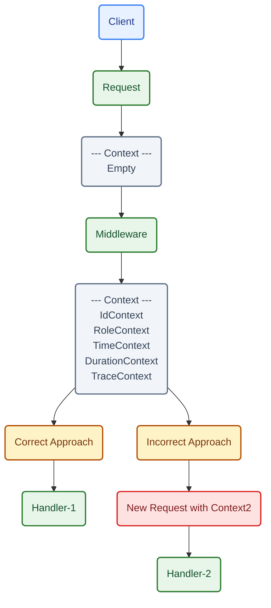

## Where I Noticed the Gap
* I was optimizing the [middleware](https://github.com/shawnfrost25/prolepsis/blob/main/internal/auth/middleware.go), I noticed that there is a way I obtain and manage to fetch the user's ID (since I used AI for the first prototype, and understood little of what I am doing). I didn't understand the concept behind the contexts, so I was really confused (also, there is a problem about it, since I didn't notice that the logger get sent via context too, since `zerolog` hides it behind a pretty command).

## The Problem
* I wanted to be able to fetch the user's role via middleware and pass to another function, since fetching role thousands of times inside each handler is extremely redundant and most of the times useless.

## Underlying Concept / How It Works
* A context's job is not only to pass values, but also to manage the lifecycyle of the request and cancel it if needed. It's extremely important to understand that the context is ephemeral, meaning that it works within the lifecycle of a request, meaning that if you want to pass values between a function and another (in whom both are called with different requests) - the context will not be able to pass values between them, since they are different requests and have different contexts. The context is a way to pass values between functions that are called within the same request, and also to manage the lifecycle of the request - exactly like this we pass the values we obtain inside the middleware to the handler.

## Workflow / Lifecycle (Diagram)

* See? A context cannot go through another request, it's bound to a single request

## Example Code and Explanation

//

## What I Still Don't Understand

//